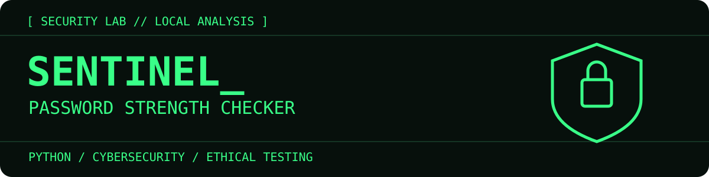

# Sentinel — Password Strength Checker

`[ DEFENSIVE SECURITY ]` `[ PYTHON 3 ]` `[ LOCAL FIRST ]`

An educational password auditing project based on the included Password Strength Checker report. The Python CLI checks five composition rules and optionally uses zxcvbn to estimate predictability. The browser edition adds a Matrix-style interface and cryptographically random password generation.

## Run the Python CLI

```bash
python3 -m venv .venv
source .venv/bin/activate
python -m pip install -r requirements.txt
python password_checker.py
```

On Windows PowerShell, activate with `.venv\Scripts\Activate.ps1` instead.

## Browser edition

Open `docs/index.html` or serve the folder:

```bash
python -m http.server 8000 --directory docs
```

Visit http://localhost:8000. The website uses local composition checks and zxcvbn guessing-time estimates when the CDN library loads. Internet access is required to load that library; password analysis runs in the browser and the application does not transmit or store passwords. Use fictional passwords only. If the library fails to load, composition checks and generation still work.

## Evidence and documentation

- [Original project report](report/Project_Report.pdf)
- [Original lab screenshots](screenshots/)
- [GitHub deployment guide](DEPLOYMENT.md)

The screenshots are extracted from the original report and depict the earlier CLI and authorized fictional-password lab, not the redesigned website.

## Security notes

Rule compliance is not a guarantee of strength. The optional CLI guessing-time estimate depends on assumptions. Use unique passwords, a password manager and MFA. The John the Ripper evidence is from a controlled lab only; never test third-party credentials without authorization.

## Tests

```bash
python -m unittest discover -s tests
```

## References

- [Python](https://docs.python.org/3/)
- [zxcvbn](https://github.com/dropbox/zxcvbn)
- [OWASP authentication guidance](https://cheatsheetseries.owasp.org/cheatsheets/Authentication_Cheat_Sheet.html)
